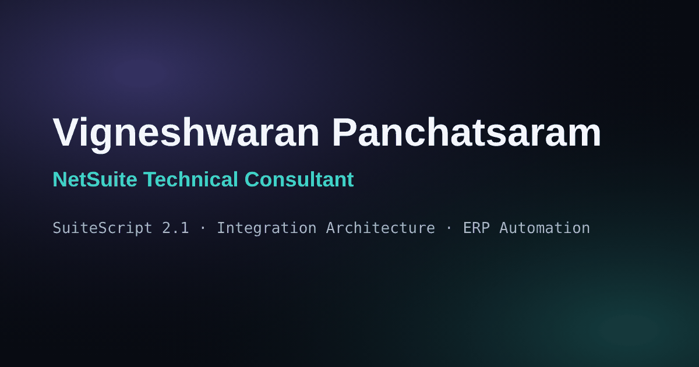

<div align="center">

# Vigneshwaran Panchatsaram — Portfolio

**NetSuite Technical Consultant · SuiteScript 2.1 · ERP Integrations · Automation · Data Migration**

The source code for my personal portfolio website, built with React and Vite.


</div>

---

## Overview

This site presents my work as an Oracle NetSuite Technical Consultant: SuiteScript development, third-party integrations, custom ERP solutions, data migration and certifications. It is a single-page React application with no backend. All content lives in plain data files, so updating the site rarely means touching a component.

## Preview

<p align="center">
  
</p>

## Features

- **Sections:** Hero, About, Technical Skills, Professional Experience, Projects & Integrations, Custom Solutions, Certifications, Technical Approach, Contact and Footer
- **Integration project cards** with a data-flow diagram, the business problem, the technical solution and an expandable "My contribution" panel
- **Project category filters** (Legal Tech, Retail, Finance & Banking, E-commerce, Data & APIs)
- **Responsive navigation** with active-section highlighting and a mobile menu (closes with `Esc`)
- **Resume download** served from `public/`
- **Contact options:** email link with copy-to-clipboard, LinkedIn and GitHub
- **Accessibility:** skip link, visible focus states, `aria-expanded` on toggles, and respect for the reduced-motion setting
- **Scroll-reveal animations** and a back-to-top button
- **Social share metadata** (Open Graph and Twitter card)

## Tech stack

| Area | Technology |
| --- | --- |
| UI | React 18 |
| Build tool | Vite 5 with `@vitejs/plugin-react` |
| Icons | Lucide React |
| Styling | Plain CSS with design tokens (`src/index.css`) |
| Fonts | Manrope and DM Mono (Google Fonts) |
| Hosting | Vercel |

## Project structure

```
vigneshwaran-portfolio/
├── public/
│   ├── favicon.svg
│   ├── og-image.png                 # social share image (1200×630)
│   └── Vigneshwaran_Panchatsaram_NetSuite_Resume.pdf
├── src/
│   ├── components/                  # Navbar, Hero, About, Skills, Experience, Projects,
│   │                                # Solutions, Certifications, Approach, Contact,
│   │                                # Footer, BackToTop, hooks.jsx, icons.jsx
│   ├── data/                        # site.js, skills.js, projects.js,
│   │                                # solutions.js, certifications.js
│   ├── App.jsx
│   ├── main.jsx
│   └── index.css                    # all styles and design tokens
├── index.html
├── package.json
├── vercel.json
└── vite.config.js
```

## Getting started

### Requirements

- Node.js 18 or newer (20 LTS recommended)
- npm 9 or newer

### Installation

```bash
git clone https://github.com/Vignesh-2108/vigneshwaran-portfolio.git
cd vigneshwaran-portfolio
npm install
```

### Local development

```bash
npm run dev
```

The site runs at http://localhost:5173 with hot reload.

### Production build

```bash
npm run build      # writes the optimized site to dist/
npm run preview    # serves dist/ at http://localhost:4173 for a final check
```

## Deployment

The site is deployed on **Vercel**, connected to this repository. Every push to `main` triggers a new production deployment.

| Setting | Value |
| --- | --- |
| Framework preset | Vite |
| Install command | `npm install` |
| Build command | `npm run build` |
| Output directory | `dist` |
| Root directory | `./` |

These settings are also recorded in `vercel.json`. To deploy your own copy, import the repository at [vercel.com/new](https://vercel.com/new) and keep the defaults.

## Updating content

| What to change | File |
| --- | --- |
| Name, contact details, LinkedIn, GitHub, resume path, availability badge | `src/data/site.js` |
| Skill groups | `src/data/skills.js` |
| Projects, data-flow diagrams and filter categories | `src/data/projects.js` |
| Custom solutions | `src/data/solutions.js` |
| Certifications and verification links | `src/data/certifications.js` |
| Resume PDF | replace the file in `public/` (keep the name or update `resume` in `site.js`) |

A certification card shows a **Verify credential** link only when its `verifyUrl` is filled in.

## Confidentiality

This repository contains only the portfolio website. It holds no client source code, credentials or internal business data. Project descriptions are written at a high level, and client names are left out.

## Contact

- **Email:** [vigneshpanchatsaram@gmail.com](mailto:vigneshpanchatsaram@gmail.com)
- **LinkedIn:** [linkedin.com/in/vigneshwaran-p-60a301282](https://linkedin.com/in/vigneshwaran-p-60a301282)
- **GitHub:** [github.com/Vignesh-2108](https://github.com/Vignesh-2108)

---

<p align="center"><i>Building scalable ERP solutions through technology.</i></p>
